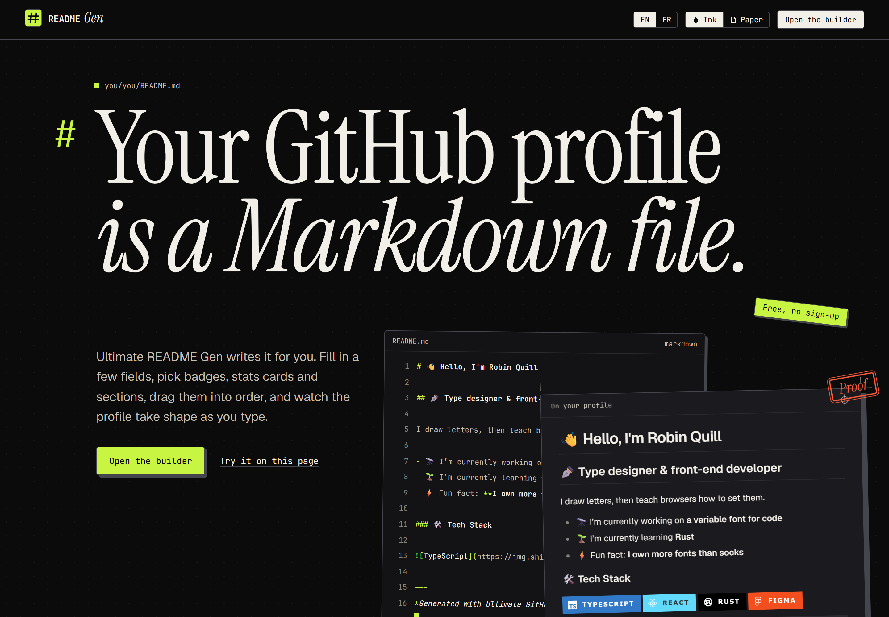
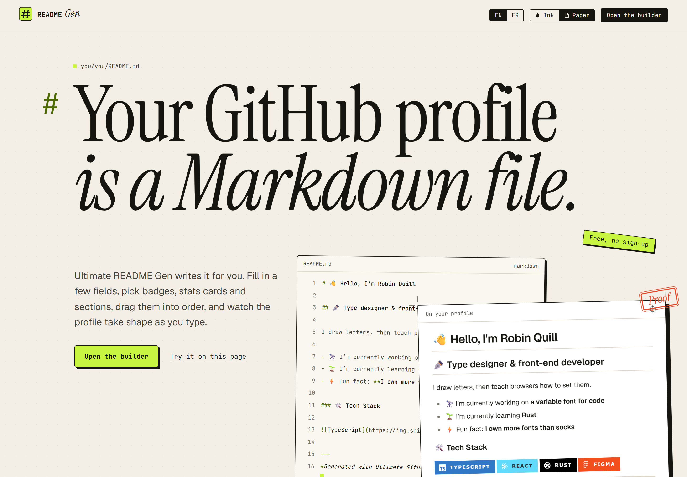

<div align="center">

# README Gen

### Your GitHub profile is a Markdown file. *This writes it.*

**Ultimate README Gen** turns a few fields into the `README.md` that GitHub shows on your profile: badges, stats cards and sections, in the order you choose, with a live preview as you type. Free, no account, saved in your browser.

[Open the builder](https://readme-profile-gen.matheodelaunay.studio/builder) · [Visit the site](https://readme-profile-gen.matheodelaunay.studio) · [Report a bug](https://github.com/D-Seonay/readme-profile-gen/issues/new)


</div>



---

## Three moves

1. **Create the repository.** A public repository named exactly like your GitHub username (`you/you`) is special: its `README.md` is shown at the top of your profile.
2. **Fill the builder.** Start with your username to pre-fill what GitHub already knows, then add sections and drag them into order.
3. **Copy, commit, done.** Copy the Markdown or download `README.md`, commit it to that repository, and your profile updates.

## What the builder does

### Auto-fill from a GitHub username

Reads public data from the GitHub API, in the browser:

- name and bio, X/Twitter handle, website, and LinkedIn from your linked social accounts;
- an email address found in your current profile README (or your public email);
- the technologies already mentioned in your current profile README, matched against the 48 the builder knows;
- your followers and the people you follow, for the network section.

### Thirteen sections, in the order you choose

| Section | What it adds |
| :-- | :-- |
| Header banner | Any image URL |
| Typing text | Animated lines ([readme-typing-svg](https://github.com/DenverCoder1/readme-typing-svg)), with size, colour, speed and pause |
| Introduction | A greeting (`{name}` is replaced by your name), a title with an emoji prefix, a bio, the classic "currently working on / learning / collaborating on / ask me about / pronouns / fun fact" lines, and free lines of your own |
| Tech stack | 48 technologies in eight categories, grouped or flat, plus custom badges |
| Modern stats | [STAT-STATS](https://github-stats-cards.matheodelaunay.studio) cards: stats, top languages, streak, top repositories, activity, trophies, organisation; 8 themes, 6 fonts, compact mode, hidden stats |
| Contact | LinkedIn, X, portfolio, email, plus custom badges |
| GitHub stats | Stats card, streak, top languages, trophies, contribution snake, visitor counter; 10 card themes |
| Support me | Buy Me a Coffee, Ko-fi, PayPal, plus custom badges |
| Featured projects | Pinned repository cards |
| WakaTime | Weekly coding activity card and badges |
| Spotify | Now playing, from the link of a Spotify profile widget you have set up |
| Latest blog posts | The placeholder block for the [blog-post-workflow](https://github.com/gautamkrishnar/blog-post-workflow) GitHub Action |
| Network | Followers and following, as badges, links or an avatar grid |

Add as many **free sections** as you like: Markdown or HTML, written as-is, reordered like the others. Empty sections are left out of the file.

### Design controls

- Left or centred layout; stats cards in a row or a column.
- Five [shields.io](https://shields.io) badge styles: `for-the-badge`, `flat`, `flat-square`, `plastic`, `social`.
- Custom badges with any label, hex colour, [Simple Icons](https://simpleicons.org) logo and link.
- Rename any section title, and switch off the optional "Generated with…" credit line.

### Working with it

- Live preview and raw Markdown; copy to the clipboard or download `README.md`.
- Your draft is saved in the browser (`localStorage`); export and import the whole setup as JSON.
- Drag-and-drop section order and a short guided tour on the first visit.
- Keyboard shortcuts in the builder: <kbd>Ctrl</kbd>/<kbd>⌘</kbd> + <kbd>S</kbd> download, <kbd>C</kbd> copy, <kbd>K</kbd> command palette, <kbd>T</kbd> theme, <kbd>L</kbd> language.
- A status light for each third-party stats service, so you know when a card is down rather than broken.
- Interface in English and French, in an ink (dark) or paper (light) theme.

### More sections

Alongside the sections above: an **animated header and footer** (capsule-render), a **contribution activity graph**, **profile summary cards**, a **dev quote or joke card**, an **experience timeline**, a **"currently" block**, and **pinned repos or gists** with your own descriptions. The tech stack can also be shown as a [skillicons.dev](https://skillicons.dev) icon grid, from a catalogue of 400+ skills.

### Templates, checks and tools

- **Templates**: ten opinionated layouts (minimal, terminal hacker, open-source maintainer, designer who codes…). A template changes presentation only; your name, links, skills and texts stay.
- **Health check**: a 0–100 score with findings and one-click fixes (no contact link, offline service, missing workflow…).
- **Workflow export**: the exact `.github/workflows/*.yml` files for the sections that need a GitHub Action (snake, blog posts, WakaTime, summary cards), with setup steps.
- **README import**: bring the content of an existing profile README in as free sections.
- **Undo / redo**: <kbd>Ctrl</kbd>/<kbd>⌘</kbd> + <kbd>Z</kbd> and <kbd>Ctrl</kbd>/<kbd>⌘</kbd> + <kbd>Shift</kbd> + <kbd>Z</kbd>, including after a reset or a template.
- **Share by link**: the whole setup, compressed into the URL hash. No account, no backend.
- **Command palette**: <kbd>Ctrl</kbd>/<kbd>⌘</kbd> + <kbd>K</kbd> to jump to a section or run any action.



## The landing page

The home page is a Server Component, so every section is in the HTML; only the parts that react to you are client components. It is set like the file it talks about, with its Markdown marks hanging in the margins:

- **Cover**: a sample README typing itself into a proof sheet (CSS only; shown finished when reduced motion is on).
- **§1 Compose**: six fields of the builder and its real engine, `utils/generateMarkdown.ts`, with a live proof. "Continue in the builder" carries the fields over, and asks before replacing a draft you already have.
- **§2 Type case**: the anatomy of a custom badge, the five badge styles rendered by shields.io, and each section with the first line of Markdown it writes.
- **§3 Proofs**: three sample profiles from the same engine, each one can be turned over to show its Markdown.
- **§4 Press run**: the three moves above.
- **§5 Questions**: the FAQ, in native `<details>` so every answer is in the HTML (and in the `FAQPage` structured data).

The Open Graph image is generated at build time (`app/opengraph-image.tsx`) with fonts from `assets/og` (SIL Open Font License, licences included).

## Template pages and search

`/templates` lists the ten templates, and `/templates/<id>` shows each one: a sample README rendered the way GitHub shows it, its section list, its Markdown source and a "Use this template" link (`/builder?template=<id>` applies it on arrival, undoable). The samples are the engine's real output (`lib/templatePreview.ts`); the search titles and "best for" lines live in `lib/templateSeo.ts`. Every template page is static and has its own social card.

Search and AI crawlers also get: one title, description and canonical per page, schema.org JSON-LD (`WebSite`, `WebApplication`, `Person`, `FAQPage`, `BreadcrumbList`, `CollectionPage`, `CreativeWork`, see `lib/structuredData.ts`), a sitemap with every page, a web manifest and an [`/llms.txt`](https://readme-profile-gen.matheodelaunay.studio/llms.txt) built from the same data.

## Design system: Atelier

An editorial print shop crossed with a terminal: warm paper and deep ink, one electric lime accent, coral used sparingly; Instrument Serif for display, JetBrains Mono for labels and code, Geist for text; 1px rules, small radii and hard, blur-less shadows.

Everything is a token in [`app/globals.css`](./app/globals.css) (`bg-canvas`, `bg-surface`, `bg-raised`, `border-line`, `border-line-strong`, `text-ink`, `text-ink-soft`, `text-muted`, `bg-accent` / `text-accent-ink`, `text-accent-text`, `bg-hot` / `text-hot-ink`, `shadow-hard`, `font-display`…). Themes switch through `<html data-theme="dark | light">`, so components never branch on the theme.

## Tech stack

| Technology | Used for |
| :-- | :-- |
| [Next.js 16](https://nextjs.org) (App Router, Turbopack) | Pages, metadata, Open Graph image, sitemap and robots |
| React 19 | UI |
| Tailwind CSS 4 + `@tailwindcss/typography` | The Atelier tokens and utilities |
| Zustand 5 (`persist`) | Builder state, saved in the browser |
| react-markdown, remark-gfm, rehype-raw | Rendering the preview the way GitHub does |
| @dnd-kit | Drag-and-drop section order |
| Framer Motion | The guided tour |
| Sonner | Toasts |
| Vitest (jsdom) | Tests for the store, the Markdown engine and the landing samples |

## Getting started

Requires Node.js 20.9 or later.

```bash
git clone https://github.com/D-Seonay/readme-profile-gen.git
cd readme-profile-gen
npm install
npm run dev
```

Then open <http://localhost:3000>.

| Script | What it does |
| :-- | :-- |
| `npm run dev` | Development server |
| `npm run build` / `npm start` | Production build and server |
| `npm run lint` | ESLint |
| `npm test` | Vitest (add `-- --run` for a single run) |

Continuous integration runs the lint, `tsc --noEmit` and the tests on every push and pull request to `main`.

## Project structure

```text
app/
  page.tsx               landing page (Server Component)
  builder/page.tsx       the builder
  templates/             template index and one static page per template
  opengraph-image.tsx    social card, generated at build time
  api/health/route.ts    status of the third-party stats services
  llms.txt/route.ts      site map for AI assistants
  layout.tsx, globals.css, sitemap.ts, robots.ts, manifest.ts, icon.svg, apple-icon.tsx
components/              builder panels
components/landing/      landing sections and their client islands
store/useReadmeStore.ts  state, persistence, JSON import/export, GitHub auto-fill
utils/generateMarkdown.ts  the engine: configuration in, README Markdown out
lib/                     translations (en, fr), known technologies, site constants
assets/og/               fonts for the Open Graph image
```

## Contributing

Issues and pull requests are welcome.

1. Fork the repository and create a branch (`git checkout -b feature/your-idea`).
2. Make your change; keep `npm run lint`, `npx tsc --noEmit` and `npm test -- --run` green.
3. Open a pull request against `main`.

---

<div align="center">

Made by [Seonay](https://matheodelaunay.studio)

*Generated with Ultimate GitHub Profile README Generator*

</div>
